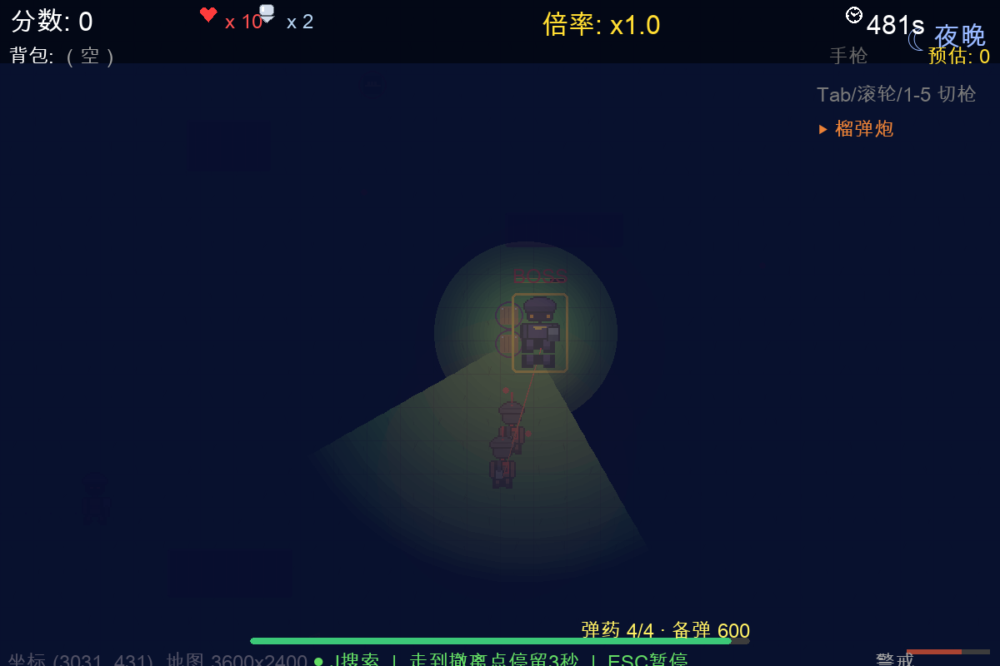
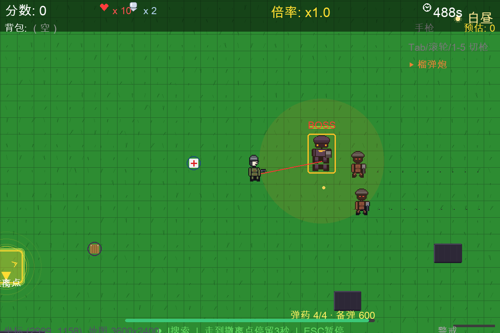
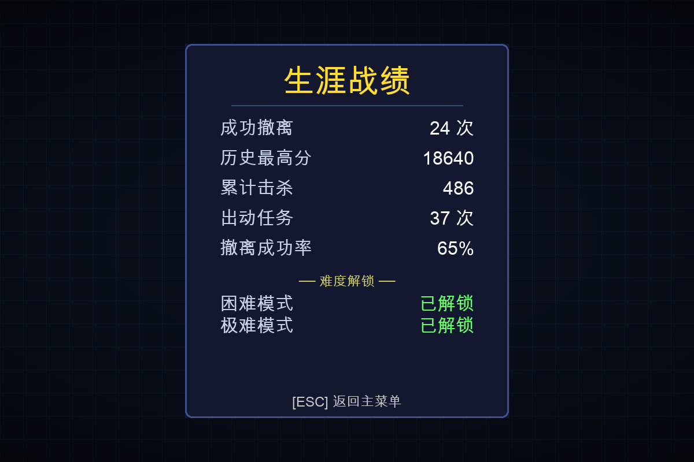
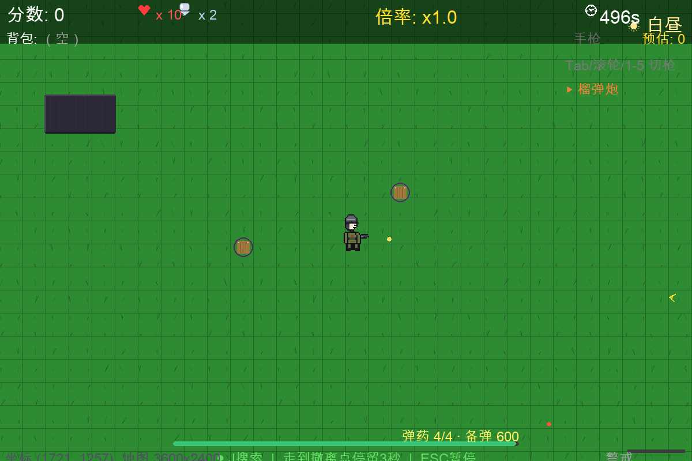

# HeliOps

> 单机俯视角「搜打撤」撤离射击 —— 搜刮物资、躲开巡逻兵与 Boss、在夜里靠一支手电突围，走到黄色撤离点，等直升机降落把你接走。
>
> Windows / macOS · 免费 · 无内购 · 中文



---

## 下载

| 平台 | 版本 | 下载 |
| --- | --- | --- |
| Windows | 10 / 11 64 位 | [HeliOps_Windows_Chinese_v1.3.3.zip](https://github.com/sunnychen786/HeliOps/releases/download/v1.3.3/HeliOps_Windows_Chinese_v1.3.3.zip) |
| macOS | 12+（Intel / Apple 芯片） | [HeliOps_Mac_Chinese_v1.3.3.zip](https://github.com/sunnychen786/HeliOps/releases/download/v1.3.3/HeliOps_Mac_Chinese_v1.3.3.zip) |

解压即玩：Windows 双击 `HeliOps.exe`，macOS 双击 `HeliOps.app`（首次需要在「系统设置 → 隐私与安全性」里放行）。

全部历史版本见 [Releases](https://github.com/sunnychen786/HeliOps/releases)。也收录在 [itch.io](https://sunnychen786.itch.io/heliops)。



---

## v1.3 带来了什么

**生涯战绩** —— 主菜单按 `T`，累计击杀、撤离次数、撤离成功率、历史最高分一目了然，难度解锁状态也在同一屏。



**榴弹炮** —— 第 5 把武器，4000 分解锁。一发 5 点伤害，但弹匣只有 4 发，打空就得停下来换弹，换弹期间完全无法射击。



**夜间作战** —— 入夜之后战场伸手不见五指，只剩一支跟着你朝向走的 90° 手电光锥。灯下看得清，光外一片漆黑。


**撤离镜头** —— 撤离不再是一句提示文字，而是一段真的镜头：直升机从天上降下来，把你连同战利品一起带走。

---

## 玩法

你是地面士兵，直升机只负责撤离接应，敌人和 Boss 都不是直升机。

- 在战区搜索补给箱，捡到武器与护甲
- 巡逻兵、猎手与 Boss 会主动开火，Boss 会一路追杀你
- 走到黄色撤离点**停留 3 秒**，直升机降落接应
- 只有活着带出去的战利品才换算成分数；被击倒这一趟就白跑了
- 分数可以在补给站买更强的装备，越难难度奖励越高

| 按键 | 作用 |
| --- | --- |
| `WASD` / 方向键 | 移动角色 |
| `空格` | 射击（自动瞄准最近的敌人） |
| `J` | 搜索物资（靠近后按住约 1.5 秒） |
| `1`–`5` / `Tab` / 滚轮 | 切换武器（手枪 / 步枪 / 霰弹枪 / 狙击枪 / 榴弹炮） |
| `R` | 换弹（每把枪独立弹匣，换弹期间无法射击） |
| `P` 或 `ESC` | 暂停 |
| 主菜单 `T` / `S` / `8` / `D` | 生涯战绩 / 设置 / 补给站 / 切换难度 |

---

## 从源码运行

游戏是一个单文件的 Pygame 程序，没有外部素材依赖。

```bash
pip install pygame
python game.py
```

进度自动保存在 `~/Documents/HeliOps/`（Windows 为 `%USERPROFILE%\Documents\HeliOps\`）。

## 打包

```bash
pip install pyinstaller

# macOS：产出 dist/HeliOps.app
python build.py
python tools/package_mac.py        # 用 ditto 打 zip（不能用 zipfile，会跟随符号链接）

# Windows：在 GitHub Actions 上构建，产出单文件 exe
# 产物下载后：
python tools/package_windows.py path/to/HeliOps.exe
```

出包后必须验一遍内嵌代码确实是当前版本：

```bash
python tools/verify_archive.py dist/HeliOps.app/Contents/MacOS/HeliOps
```

## 无头测试

仓库里带了一套无头行为测试（不需要显示器，也不碰你的存档）：

```bash
python tools/test_reload.py          # 换弹逻辑
python tools/test_extract_ammo.py     # 撤离与弹药
python tools/test_extract_lift.py     # 撤离直升机镜头
python tools/test_font_cjk.py         # 字体能否渲染中文（Windows 出包前必跑）
```

## 技术

- Python 3.13 + Pygame 2.6，**零外部素材**：角色、掩体、战利品布局与全部音效都是程序生成的
- 单文件 `game.py`（约 4300 行），双击即玩
- macOS 包是 Intel 原生构建，Apple 芯片通过 Rosetta 运行

## 许可

源码开放用于学习与二次创作。游戏本体免费、无内购。

问题反馈：<https://sunnychen786.itch.io/heliops>
